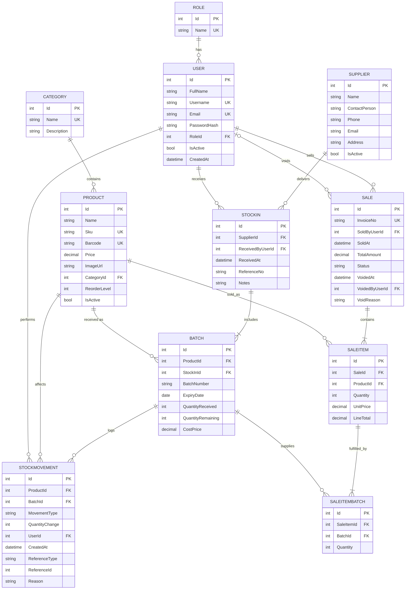

# Initial Data Model

## 1. Core Entities

| # | Entity | Purpose |
|---|--------|---------|
| 1 | Role | The three system roles |
| 2 | User | System accounts |
| 3 | Category | Medicine categories |
| 4 | Product | Medicine catalog item |
| 5 | Supplier | Pharma companies / distributors |
| 6 | StockIn | Header of a delivery received from a supplier |
| 7 | Batch | Received lot of a product, including batch number, expiry date, and remaining quantity |
| 8 | StockMovement | Immutable log of every stock change |
| 9 | Sale | Header of a sales invoice |
| 10 | SaleItem | Individual product line in a sale |
| 11 | SaleItemBatch | Records which batches and quantities fulfilled a sale item; supports FEFO allocation across multiple batches |

## 2. Relationships

| Relationship | Cardinality |
|--------------|-------------|
| Role - User | 1 : N |
| Category - Product | 1 : N |
| Supplier - StockIn | 1 : N |
| User - StockIn (received by) | 1 : N |
| StockIn - Batch | 1 : N |
| Product - Batch | 1 : N |
| Batch - StockMovement | 1 : N |
| Product - StockMovement | 1 : N |
| User - StockMovement (performed by) | 1 : N |
| User - Sale (sold by) | 1 : N |
| User - Sale (voided by) | 1 : N, optional |
| Sale - SaleItem | 1 : N |
| Product - SaleItem | 1 : N |
| SaleItem - SaleItemBatch | 1 : N |
| Batch - SaleItemBatch | 1 : N |

## 3. Entity Relationship Diagram



## 4. Key Constraints

### 4.1 Unique Constraints

- `Role.Name` must be unique.
- `User.Username` must be unique.
- `User.Email` must be unique.
- `Product.Sku` must be unique.
- `Product.Barcode` must be unique when provided; multiple products may have a NULL barcode.
- `Batch` must be unique on (`ProductId`, `BatchNumber`).
- `Sale.InvoiceNo` must be unique.
- `SaleItemBatch` must be unique on (`SaleItemId`, `BatchId`).

**SQL Server note:** Use a filtered unique index for the optional barcode:

```sql
CREATE UNIQUE INDEX UX_Product_Barcode
ON Product(Barcode)
WHERE Barcode IS NOT NULL;
```

### 4.2 CHECK Constraints

- `Product.Price > 0`.
- `Product.ReorderLevel >= 0`.
- `Batch.QuantityReceived > 0`.
- `Batch.QuantityRemaining >= 0`.
- `Batch.QuantityRemaining <= Batch.QuantityReceived`.
- `Batch.CostPrice >= 0` when provided.
- `SaleItem.Quantity > 0`.
- `SaleItem.UnitPrice > 0`.
- `SaleItem.LineTotal > 0`.
- `SaleItemBatch.Quantity > 0`.
- `StockMovement.QuantityChange <> 0`.

### 4.3 Allowed Values

- `StockMovement.MovementType`: `StockIn`, `Sale`, `Adjustment`, `Void`.
- `Sale.Status`: `Completed`, `Voided`.

### 4.4 Business and Data Integrity Rules

- Every stock-in line creates a separate `Batch` record.
- Batch expiry dates are mandatory and must be in the future when stock is received.
- Expired batches are retained for history but excluded from available stock and cannot be sold.
- Current available stock for a product is calculated as the sum of `Batch.QuantityRemaining` for non-expired batches. It is computed, not stored separately.
- FEFO (First Expired, First Out) must be used when allocating batches to sales.
- The sum of `SaleItemBatch.Quantity` for a sale item must equal `SaleItem.Quantity`.
- Every batch allocated to a sale item must belong to the same product as that sale item.
- `SaleItem.UnitPrice` stores the product price at the time of sale, preserving historical pricing.
- `SaleItem.LineTotal` and `Sale.TotalAmount` must match their corresponding quantity and price calculations.
- Stock movements are append-only: existing movement records must not be updated or deleted.
- Every stock change must create a corresponding `StockMovement` record.
- An initial positive `StockIn` movement must be recorded when a batch is received.
- For each batch, the following invariant must hold:

  `QuantityRemaining = QuantityReceived + SUM(QuantityChange)`

- Movement quantities are signed:
  - Stock-in: positive.
  - Sale: negative.
  - Adjustment: positive or negative.
  - Void: positive, restoring the quantities to the original batches used by the sale.
- If a void restores stock to a batch that has since expired, that batch remains excluded from available stock.
- Adjustments must include a reason.
- Sale voiding must record `VoidedAt`, `VoidedByUserId`, and `VoidReason`.

## 5. Transactions and Referential Integrity

- Stock-in creation (StockIn, Batches, and StockMovements) must run in one database transaction.
- Sale confirmation (Sale, SaleItems, SaleItemBatches, batch quantity updates, and StockMovements) must run in one database transaction.
- Stock adjustments (batch quantity update and StockMovement creation) must run in one database transaction.
- Sale voiding (sale status update, batch quantity restoration, and reversing StockMovements) must run in one database transaction.
- Stock must never become negative.
- Historical records such as sales, batches, and stock movements must not be hard-deleted.
- Use restricted foreign-key deletion behavior for records that have dependent historical data. Avoid cascade deletion of important business records.
- Products, suppliers, and users with relevant transaction history should be deactivated rather than deleted.

## 6. Normalization and Design Notes

- The model is designed around relational database normalization, targeting Third Normal Form (3NF).
- `SaleItem.UnitPrice` is intentionally stored as a historical price snapshot, even though the current selling price also exists in `Product`.
- Available stock is calculated from batch records rather than maintained as a separate product quantity, avoiding inconsistencies.
- `SaleItemBatch` supports FEFO allocation and preserves the exact batch-level quantities consumed by each sale.
- `StockMovement.ReferenceType` and `ReferenceId` identify the source record. Because this is a polymorphic reference, referential integrity to the source table must be handled by application logic or replaced with explicit foreign keys if required.
- Detailed column types, nullability, indexes, and EF Core configurations will be defined during implementation.